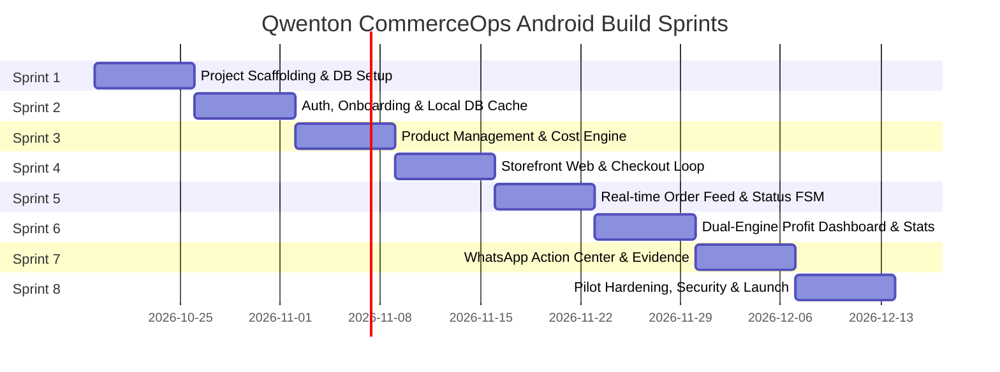

# Qwenton CommerceOps — Android Application Master Plan

This document establishes the production-grade architectural blueprint, directory layout, UI/UX specifications, state management flows, and sprint-by-sprint implementation guide for building the **Qwenton CommerceOps** Android application.

---

## 1. Executive Summary & Tech Stack

### Target Platform
- **Target OS:** Android 9.0+ (API Level 28+)
- **Primary Framework:** **Flutter 3.x with Dart 3.x**
  - *Why Flutter?* Delivers consistent 60fps animations on low-spec Indian budget hardware (e.g. MediaTek Helio G-series, Snapdragon 680), hot-reload for rapid iterations, first-class Indian language typography (Hindi/Devanagari rendering), and built-in cross-compilation capability.
- **Backend-as-a-Service:** **Supabase (PostgreSQL 16, Auth, Storage, Edge Functions, Realtime)**
- **Public Storefront:** Lightweight mobile-web application (Next.js 14 App Router / Edge SSR) served via CDN to allow zero-install customer checkout from Instagram, WhatsApp, and YouTube Shorts.

### Core Flutter Dependencies
```yaml
dependencies:
  flutter:
    sdk: flutter
  flutter_localizations:
    sdk: flutter
  intl: ^0.19.0

  # State Management & DI
  flutter_riverpod: ^2.5.1
  riverpod_annotation: ^2.3.5
  freezed_annotation: ^2.4.1

  # Navigation & Deep Linking
  go_router: ^14.0.0

  # Backend & Network
  supabase_flutter: ^2.5.0
  dio: ^5.4.3
  connectivity_plus: ^6.0.3

  # Local Database & Offline Sync
  drift: ^2.18.0
  sqlite3_flutter_libs: ^0.5.21
  path_provider: ^2.1.3
  path: ^1.9.0

  # Native Device & Hardware Access
  url_launcher: ^6.3.0        # WhatsApp & UPI deep links
  image_picker: ^1.1.0        # Product photos & camera
  share_plus: ^9.0.0          # Native Android share sheet
  file_picker: ^8.0.0         # CSV imports
  csv: ^6.0.0                 # CSV generation & parsing

  # UI, Icons & Charts
  lucide_icons: ^0.257.0      # Clean, non-distracting UI icons
  fl_chart: ^0.68.0           # Smooth profit & order analytics
  cached_network_image: ^3.3.1
  shimmer: ^3.0.0             # Skeleton loading states

dev_dependencies:
  flutter_test:
    sdk: flutter
  build_runner: ^2.4.9
  riverpod_generator: ^2.4.0
  freezed: ^2.5.1
  json_serializable: ^6.8.0
  drift_dev: ^2.18.0
```

---

## 2. Android Project Architecture (`apps/android`)

Follow **Feature-Driven Clean Architecture** to enforce modularity and ensure multi-agent/multi-developer scalability:

```text
apps/android/
├── android/                             # Native Android configuration (Manifest, Gradle, ProGuard)
│   ├── app/
│   │   ├── build.gradle
│   │   └── src/main/
│   │       ├── AndroidManifest.xml      # Intent filters for UPI & WhatsApp
│   │       └── res/                     # App icons & splash screens
├── lib/
│   ├── core/                            # App-wide infrastructure
│   │   ├── constants/                   # App constants, API routes, asset paths
│   │   ├── errors/                      # Failure & Exception classes
│   │   ├── network/                     # Supabase client, Dio interceptors, retry policies
│   │   ├── local_db/                    # Drift SQLite database, tables, DAOs
│   │   ├── theme/                       # Color scheme (OKLCH-derived high contrast), typography
│   │   └── utils/                       # Currency formatter (Paise -> ₹), Date formats
│   ├── features/                        # Domain-driven feature slices
│   │   ├── auth/                        # Phone OTP login & session management
│   │   │   ├── data/                    # Auth repository & remote data source
│   │   │   ├── domain/                  # User model & auth state
│   │   │   └── presentation/            # PhoneInputScreen, OtpVerificationScreen
│   │   ├── onboarding/                  # Business setup & initial cost assumptions
│   │   │   ├── domain/                  # BusinessProfile model
│   │   │   └── presentation/            # BusinessProfileScreen, LanguagePicker
│   │   ├── products/                    # Catalog, Variants, Cost Breakdowns
│   │   │   ├── data/                    # ProductRepository, sync logic
│   │   │   ├── domain/                  # Product, Variant, CostModel entities
│   │   │   └── presentation/            # ProductListScreen, AddEditProductScreen, VariantSheet
│   │   ├── storefront/                  # Storefront link generation & QR sharing
│   │   │   ├── domain/                  # StorefrontLink entity
│   │   │   └── presentation/            # ShareLinkDialog, QrCardScreen
│   │   ├── orders/                      # Order Feed, Status State Machine
│   │   │   ├── data/                    # OrderRepository, Realtime stream subscription
│   │   │   ├── domain/                  # Order, Customer, OrderStatus enums
│   │   │   └── presentation/            # OrderFeedScreen, OrderDetailScreen, StatusFilterChips
│   │   ├── profit_engine/               # Financial Analytics & Contribution Margins
│   │   │   ├── domain/                  # ProfitCalculator, ProfitSummary entity
│   │   │   └── presentation/            # ProfitDashboardScreen, CostAnatomyCard
│   │   ├── payments/                    # Payment Evidence & UTR Auditing
│   │   │   ├── domain/                  # PaymentEvidence entity
│   │   │   └── presentation/            # EvidenceReviewModal, UtrInputSheet
│   │   ├── communication/               # WhatsApp Templates & Deep Links
│   │   │   ├── domain/                  # MessageTemplate model
│   │   │   └── presentation/            # TemplatePickerSheet, QuickMessageButton
│   │   └── settings/                    # Team members, CSV Import/Export, Account Deletion
│   │       └── presentation/            # SettingsScreen, TeamMemberScreen, CsvExportSheet
│   ├── l10n/                            # Localization files
│   │   ├── app_en.arb                   # English strings
│   │   └── app_hi.arb                   # Hindi strings (हिंदी)
│   ├── shared/                          # Reusable UI widgets
│   │   ├── widgets/                     # Custom buttons, textfields, status badges
│   │   └── empty_states/                # Empty & Error state illustrations
│   └── main.dart                        # App entry point, Riverpod Scope & initialization
└── test/                                # Unit, widget, and mock integration tests
```

---

## 3. Screen Specifications & UX Flows

### 3.1 Mobile UX Principles for Indian Social Sellers
1. **Zero Financial Ambiguity:** All amounts display both **Selling Price** and **True Net Profit**. Profit is color-coded (Emerald green for positive, Crimson red for negative/loss).
2. **One-Handed Operational Speed:** Primary actions (Share Link, Update Status, WhatsApp Reminder) are placed in the lower 40% of the screen (thumb-friendly).
3. **Honest Status Badging:** Screenshot evidence is highlighted in amber as `"Needs Review"`, never deceptive green `"Verified"`.
4. **Large Tap Targets:** Minimum 48dp x 48dp touch targets for fast operation in busy environments.

### 3.2 Screen Blueprint

```text
+-----------------------------------------------------------------------------------+
| 1. DASHBOARD & ORDER FEED SCREEN                                                  |
+-----------------------------------------------------------------------------------+
|  [ Business Name v ] [ Active: 14 Products ]             [ QR Share ] [ Settings ]|
|-----------------------------------------------------------------------------------|
|  METRIC SUMMARY CARDS (HORIZONTAL CAROUSEL):                                      |
|  +--------------------+  +--------------------+  +--------------------+           |
|  | Today's Orders     |  | Pending Payment    |  | Estimated Profit   |           |
|  | 18 Orders (₹14,200)|  | 6 Orders (₹4,800)  |  | ₹5,120 (36% margin)|           |
|  +--------------------+  +--------------------+  +--------------------+           |
|-----------------------------------------------------------------------------------|
|  FILTER CHIPS: [ All (18) ] [ Needs Review (4) ] [ To Pack (5) ] [ Shipped (7) ]   |
|-----------------------------------------------------------------------------------|
|  ORDER CARD ITEM:                                                                 |
|  #QC-1082  *  Pooja Sharma (Jaipur, RJ)                        22 mins ago        |
|  Product: Chikankari Kurti - Pastel Pink (Size M x 1)                             |
|  Total: ₹899  |  Expected Profit: ₹340 (37.8%)                                    |
|  [ Payment: UPI - Needs Review ]             [ Status: Payment Pending ]          |
|  -------------------------------------------------------------------------------  |
|  [ (WA) Send Reminder ] [ View Evidence ] [ Mark Paid / Pack ]                    |
+-----------------------------------------------------------------------------------+

+-----------------------------------------------------------------------------------+
| 2. ORDER DETAIL SCREEN & PROFIT BREAKDOWN                                         |
+-----------------------------------------------------------------------------------+
|  <- Back to Orders                     Order #QC-1082                             |
|-----------------------------------------------------------------------------------|
|  STATUS PIPELINE:                                                                 |
|  [Pending] ===> [Paid/Confirmed] ===> [Packed] ===> [Shipped] ===> [Delivered]    |
|-----------------------------------------------------------------------------------|
|  CUSTOMER DETAILS:                                                                |
|  Name: Pooja Sharma                Phone: +91 98765 43210 [ Call ] [ WhatsApp ]   |
|  Address: Flat 402, Royal Palms, Vaishali Nagar, Jaipur, Rajasthan - 302021       |
|-----------------------------------------------------------------------------------|
|  TRUE PROFIT ANATOMY (PAISE PRECISION):                                           |
|  Selling Price:                  + ₹899.00                                        |
|  Discount Applied:               -  ₹50.00                                        |
|  Net Realised Revenue:             ₹849.00                                        |
|  -------------------------------------------------------------------------------  |
|  (-) Product Cost (COGS):        - ₹320.00                                        |
|  (-) Packaging Overhead:         -  ₹25.00                                        |
|  (-) Courier / Shipping:         -  ₹70.00                                        |
|  (-) Gateway / UPI Fee (2%):     -  ₹17.00                                        |
|  (-) Expected Return Reserve:    -  ₹42.00  (Based on 5% historical return rate)  |
|  (-) Expected RTO Provision:     -  ₹35.00  (Based on 10% RTO courier loss)       |
|  ===============================================================================  |
|  ESTIMATED NET PROFIT:           = ₹340.00 (40.0% Contribution Margin)            |
|  [ Edit Cost Assumptions for this Order ]                                         |
|-----------------------------------------------------------------------------------|
|  PAYMENT EVIDENCE & AUDIT:                                                        |
|  Evidence Type: Screenshot + UTR (412984928192)                                   |
|  Status: [ Needs Review - Amber Badge ]                                           |
|  [ View Screenshot Preview Modal ]                                                |
|  [ Reject Evidence ]                         [ Confirm & Verify Payment ]         |
|-----------------------------------------------------------------------------------|
|  WHATSAPP ACTION SHORTCUTS:                                                       |
|  [ Send "Payment Received" ] [ Send "Packed & Tracking" ] [ Send "Custom Update" ]|
+-----------------------------------------------------------------------------------+
```

---

## 4. Phase-by-Phase Implementation Plan



### Sprint 1: Architecture & Foundation (Days 1–7)
- Initialize Git repository with monorepo structure:
  - `apps/android` (Flutter app)
  - `apps/storefront` (Mobile-web storefront)
  - `backend/supabase` (Migrations, seeds, edge functions)
- Setup Supabase project with local Docker environment. Run base SQL migrations for `businesses`, `products`, `orders`, and RLS policies.
- Build Android Flutter foundation with Riverpod 2.x and GoRouter navigation graph.
- Configure themes, color tokens, and Hindi (`app_hi.arb`) / English (`app_en.arb`) localization templates.

### Sprint 2: Auth, Onboarding & Business Context (Days 8–14)
- Implement Phone OTP Auth flow with developer mock toggle (bypass SMS costs in dev).
- Create Seller Onboarding Wizard:
  - Business name, preferred language, WhatsApp contact number.
  - Default cost inputs: Default shipping cost (₹), default packaging cost (₹), standard return/RTO loss buffer.
- Setup Drift SQLite local storage for user profile, offline session tokens, and business settings.

### Sprint 3: Product Catalogue & Unit Cost Engine (Days 15–21)
- Build Product List with search, category filtering, and out-of-stock badges.
- Build Add/Edit Product Form:
  - Photo upload with local image compression (<500KB) and background upload to Supabase Storage.
  - Variant builder (Sizes, Colors, Custom attributes).
  - Financial Inputs: Selling price, Product cost (COGS), Packaging cost, Shipping allowance, Expected return % and RTO %.
  - Instant live margin preview widget: *“Your profit per unit sold will be ₹340 (40%)”*.
- Public Storefront Link generator: Generate unique 10-character alphanumeric slugs with one-tap clipboard copy and QR code preview.

### Sprint 4: Public Mobile-Web Storefront & Order Ingestion (Days 22–28)
- Build lightweight mobile-web checkout (Next.js / SvelteKit / Edge SSR):
  - Ultra-fast first contentful paint (< 1.5s).
  - Single-page mobile view: Image carousel, variant selector, quantity picker.
  - Customer checkout form: Full Name, 10-digit Phone, Delivery Address, 6-digit Indian PIN code.
  - Payment mode toggle: **UPI Intent** vs **Cash on Delivery (COD)**.
  - Generates UPI intent URL (`upi://pay?pa=...&pn=...&am=...&cu=INR&tn=QC-XXXX`).
  - Fallback QR Code modal with manual UTR input and payment screenshot file upload.
- Security enforcement: Storefront API endpoint strictly excludes all seller cost and profit columns.

### Sprint 5: Real-time Order Management & Finite State Machine (Days 29–35)
- Connect Android app to Supabase Realtime websocket channel for instant order popups (< 3s latency).
- Order Feed screen with tabbed filters (`All`, `Pending Review`, `To Pack`, `In Transit`, `Completed`, `Returns/RTO`).
- Order State Machine:
  - Enforce valid state transitions (e.g., cannot move from `Payment Pending` directly to `Shipped`).
  - Audit logging: Record every status change with timestamp and actor ID in `order_events`.
- Order Detail screen with customer calling and WhatsApp intent actions.

### Sprint 6: Dual-Engine Profit Dashboard (Days 36–42)
- Implement the exact mathematical formula in Dart with Integer minor units (Paise):
  ```dart
  class ProfitEngine {
    static OrderProfit calculateEstimatedProfit({
      required int sellingPriceMinor,
      required int discountMinor,
      required int productCostMinor,
      required int packagingCostMinor,
      required int shippingCostMinor,
      required double paymentFeeRate,
      required double expectedReturnRate,
      required double expectedRtoRate,
    }) {
      final netSales = sellingPriceMinor - discountMinor;
      final paymentFee = (netSales * paymentFeeRate).round();
      final expectedReturnCost = (netSales * (expectedReturnRate / 100.0) * 0.5).round();
      final expectedRtoCost = (shippingCostMinor * 2 * (expectedRtoRate / 100.0)).round();

      final estimatedProfit = netSales 
          - productCostMinor 
          - packagingCostMinor 
          - shippingCostMinor 
          - paymentFee 
          - expectedReturnCost 
          - expectedRtoCost;

      return OrderProfit(
        netSalesMinor: netSales,
        paymentFeeMinor: paymentFee,
        expectedReturnCostMinor: expectedReturnCost,
        expectedRtoCostMinor: expectedRtoCost,
        estimatedProfitMinor: estimatedProfit,
      );
    }
  }
  ```
- Build Profit Dashboard with real-time recalculation upon updating any order cost item.
- Metric charts (FL Chart) showing daily net profit trend vs. gross GMV.

### Sprint 7: WhatsApp Action Center & Payment Auditing (Days 43–49)
- WhatsApp Action Center:
  - Pre-configured customizable templates in Hindi and English:
    1. *Order Confirmation*
    2. *UPI Payment Reminder with dynamic amount and link*
    3. *COD Address & Order Confirmation*
    4. *Tracking Details with Courier Name & Tracking Number*
    5. *Delivered & Feedback Check-in*
  - Uses native Android `url_launcher` with `whatsapp://send?phone=...&text=...` (no unofficial scraping or account banning risk).
- Payment Evidence Reviewer:
  - Secure signed URL viewer with pinch-to-zoom for uploaded payment screenshots.
  - Side-by-side UTR comparison with seller bank alerts.
  - Status toggle: `Needs Review` -> `Verified by Seller` or `Rejected`.

### Sprint 8: Offline Sync, Security Hardening & Pilot Validation (Days 50–56)
- Setup Drift SQLite offline cache for active orders and product catalog.
- Implement CSV Export for accounting (Tally / Zoho / Excel compatible) and CSV Product Import.
- RBAC Team settings: Add Staff members with restricted permissions (hide financial settings and bank details).
- Conduct strict privacy and threat audit:
  - Verify RLS policies isolate `business_id`.
  - Confirm phone numbers and addresses are stored encrypted.
  - Implement full Account Deletion and data purge endpoint.
- Seed demo data for instant new-seller evaluation.
- Device testing on entry-level Android devices (2GB/3GB RAM).

---

## 5. Security, Privacy & Compliance Matrix

| Vulnerability / Risk | Mitigation Strategy | Implementation |
| :--- | :--- | :--- |
| **Cross-Tenant Data Leak** | PostgreSQL Row-Level Security (RLS) | Enforce `business_id = (SELECT business_id FROM business_members WHERE user_id = auth.uid())` on all operational tables. |
| **PII Data Exposure** | Column encryption & sanitization | Customer phone numbers and addresses encrypted with AES-256 before disk persistence; logs sanitize all PII. |
| **Fake Payment Screenshots** | Non-custodial verification badge | System marks screenshots strictly as `"Needs Review"`; seller must actively verify in their banking app. |
| **Storefront Scraping & Abuse** | Tokenized URLs & Rate Limiting | Storefront URLs use unguessable 64-bit random slugs; IP rate limits on public checkout endpoints. |
| **DPDP Act (India 2023) Compliance** | Customer consent & Account Deletion | Storefront checkout requires explicit consent checkbox; one-tap account deletion endpoint permanently purges or anonymizes customer PII. |

---

## 6. Verification & Acceptance Checklist

- [x] **A seller can onboard in under 3 minutes** and configure business name, WhatsApp, and default shipping costs.
- [x] **A seller can create a product** with images, variants, and complete cost breakdown in under 3 minutes.
- [x] **A customer can open the storefront link** in mobile browser and complete a COD or UPI order in under 60 seconds with zero app download.
- [x] **New orders appear in the Android seller dashboard** in under 5 seconds via real-time websockets.
- [x] **Estimated vs. Realised profit is calculated to the exact Paisa** and dynamically updates when actual courier or packaging costs change.
- [x] **WhatsApp templates launch seamlessly** into the official WhatsApp Android app with pre-filled customer details and tracking codes.
- [x] **Staff accounts cannot view or modify financial settings**, bank details, or payout preferences.
- [x] **App cold-start time is under 2.0 seconds** on budget Android devices with smooth 60fps list scrolling.
